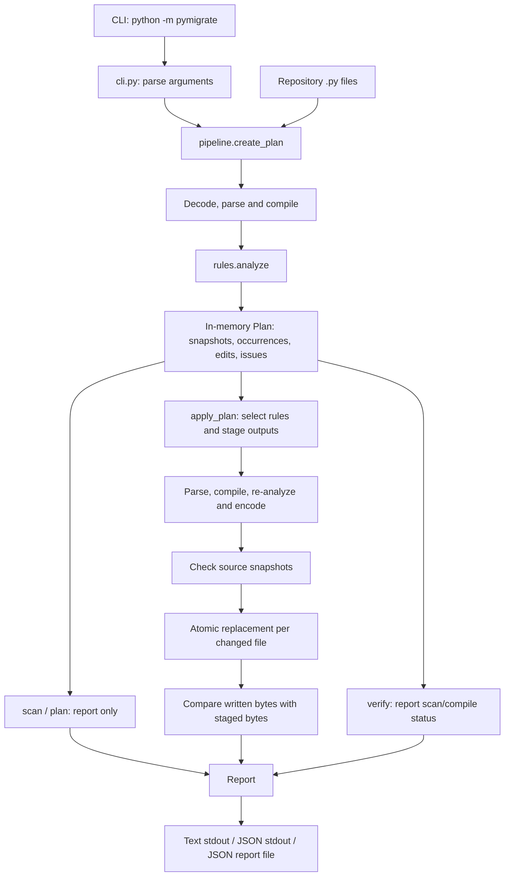

# PyMigrate Architecture

## 1. Purpose and scope

PyMigrate is a local, dependency-free Python API migration tool. It discovers
candidate calls across a repository, prepares source edits, verifies generated
code, applies approved changes, and produces human- or machine-readable reports.

The MVP implements exactly three rules:

| Rule ID | Migration | Risk | Selection |
|---|---|---|---|
| `logging-warn` | `logging.warn(...)` -> `logging.warning(...)` | Low | Default |
| `time-clock` | `time.clock(...)` -> `time.perf_counter(...)` | Medium | `--allow-risky` |
| `path-exists` | `os.path.exists(path)` -> `Path(path).exists()` | High | `--allow-risky` |

It requires Python 3.10 or later. Parsing and compilation use the running
interpreter; they do not certify compatibility with other Python versions.

Current inputs are **directories**, not individual source-file paths. To isolate
one file, copy it into a dedicated directory before scanning or applying.

Non-goals include proving runtime equivalence, executing target-project tests,
resolving every possible Python binding, supporting plugin-loaded rules, and
providing repository-wide transactional rollback.

## 2. System overview



The logical pipeline is:

```text
Scan -> Plan -> Apply -> Verify -> Report
```

These are not five independent persisted stages. Scanning and planning happen
together inside `create_plan`. Application includes output verification before
writes and byte verification afterward. The separate `verify` command rebuilds
a plan to check the current repository without changing it.

There is no service, database, network call, or background worker. Execution is
synchronous in one process, using the Python standard library.

## 3. Module boundaries

| Module | Responsibility |
|---|---|
| [models.py](pymigrate/models.py) | Rule metadata and shared dataclasses |
| [rules.py](pymigrate/rules.py) | Import binding analysis, call matching, edit generation and source rewriting |
| [pipeline.py](pymigrate/pipeline.py) | Repository traversal, decoding, planning, staging, verification and file replacement |
| [cli.py](pymigrate/cli.py) | Argument parsing, command routing, text/JSON serialization and exit codes |
| [__main__.py](pymigrate/__main__.py) | `python -m pymigrate` entry point |
| [__init__.py](pymigrate/__init__.py) | Public pipeline function exports |
| [tests](tests) | Pipeline and CLI regression tests |
| [examples](examples) | Reusable source fixtures for manual and automated migration tests |

Dependency direction:

```text
__main__ -> cli -> pipeline -> rules -> models
             |        |
             +------> models
                      ^
                      |
                  pipeline
```

`models` does not depend on execution or presentation modules. `rules` does not
perform filesystem writes. The pipeline does not format CLI output.

The public library surface exports `create_plan`, `apply_plan`, and
`verify_repository`. The installed `pymigrate` console script routes to
`cli.main`.

## 4. Data model

| Model | Important fields | Role |
|---|---|---|
| `Rule` | `id`, `source`, `replacement`, `risk`, `caveat` | Describes one migration and its behavioral warning |
| `Occurrence` | `file`, `line`, `column`, `rule`, `risk`, `supported`, `reason` | Identifies a matched call and whether its shape is supported |
| `Issue` | `file`, `message` | Records a scan, verification or application failure |
| `Edit` | `start`, `end`, `replacement` | Defines a source-string replacement over a half-open range |
| `SourceFile` | `path`, `original`, `source`, `encoding`, `occurrences`, `edits` | Keeps the original byte snapshot and edits grouped by rule |
| `Plan` | `root`, `files_scanned`, `files`, `issues` | Aggregates scan results; exposes a flattened occurrence list |
| `Report` | Operation, counts, occurrences, verification, issues | Represents the user-visible result |

Rule metadata, occurrences, issues and edits are frozen dataclasses. Plans,
source-file containers and reports are mutable during processing.

Plans exist only in memory. JSON reports do not contain the source snapshots or
edit objects needed to replay a migration, and cannot be loaded as executable
plans. Every CLI application creates a fresh plan.

Occurrence line and column values are 1-based. The current column value is the
AST's UTF-8 byte column plus one, rather than a Unicode display-column count.
Edit offsets are converted separately into Python string indexes.

## 5. Pipeline behavior

### 5.1 Scan and plan

`create_plan(root, excludes)`:

1. Converts the root into an absolute path and requires a non-symlink directory.
2. Walks directories without following symbolic links, sorting directory and
   file names for stable traversal.
3. Prunes default exclusions and user-specified directory names at every depth.
4. Counts eligible `.py` files and reads their original bytes.
5. Detects encoding with `tokenize.detect_encoding`, then decodes the source.
6. Parses the source into an AST and compiles that AST without executing it.
7. Calls `analyze` to collect occurrences and per-rule edits.
8. Retains successful source snapshots and records failures as issues.

Default exclusions are `.git`, `.hg`, `.svn`, `.venv`, `venv`, `__pycache__`,
`node_modules`, `build`, and `dist`. Symlink files are skipped as well.

A failed file contributes to `files_scanned`, but not to the successfully
analyzed `SourceFile` list. Directory traversal errors are reported rather than
silently treated as an empty directory.

### 5.2 Rule selection and staging

`apply_plan(plan, allow_risky=False)` first builds a report and chooses the
low-risk rule, or all three rules when explicitly opted in.

An occurrence is skipped if its call shape is unsupported or its rule was not
selected. A pre-existing plan issue immediately prevents application.

For each file with selected edits, application:

1. Rewrites source in memory.
2. Parses and compiles the result.
3. Re-analyzes it and rejects remaining supported candidates for selected rules.
4. Encodes it using the original encoding.
5. Compiles the serialized bytes, checking coding-cookie/BOM compatibility.
6. Stages the bytes and the number of migrated call sites.

All outputs are staged before the first source write. Any staging error blocks
all writes.

### 5.3 Snapshot validation and writes

Before writing, every successfully scanned file is compared with its original
byte snapshot, including files that do not need edits. A changed or unreadable
file, or a file replaced by a symlink, aborts the write phase.

Each staged file is checked again immediately before replacement. The
`atomic_write` helper:

1. Creates a temporary file in the destination's parent directory.
2. Writes and flushes the bytes, then calls `os.fsync`.
3. Applies the destination's existing permission bits when available.
4. Replaces the destination with `os.replace`.
5. Removes any remaining temporary file during cleanup.

Application then reads the destination and checks that its bytes match the
verified output.

This is atomic **per file**, not across the repository. A write failure stops
later replacements; earlier successful replacements remain. Reports count files
after successful replacement, so a later readback failure can report both
modified files and a failed verification.

Snapshot checks detect changes but are not locks. A concurrent edit can still
race with a check. Permission-bit preservation is not a guarantee of preserving
timestamps, ownership, extended attributes, or every platform-specific ACL.
File flushing and replacement do not constitute a repository-wide crash-recovery
protocol.

### 5.4 Independent verification

`verify_repository` creates a fresh plan and returns `PASS` if it has no issues.
It checks parsing, compilation and successful analysis, but does not require
deprecated calls to be absent.

No phase imports or executes target-project code, and no phase invokes the
target project's test suite.

## 6. AST-guided transformation design

### Conservative import resolution

`_bindings` collects imported names and potential rebindings across the entire
AST. It accepts a binding only when it has a single counted binding and
originates from an unconditional, module-level import.

Assignments, deletions, parameters, definition names, exception targets,
pattern captures, additional imports and attribute writes can make an imported
name ambiguous. Any wildcard import disables matching for the file.

This deliberately prefers false negatives over rewriting a name whose meaning
is uncertain. An ambiguity in one scope can suppress candidates elsewhere in
the same file. Such suppressed calls are not occurrences and do not contribute
to skipped-call counts.

`analyze` resolves dotted callees through these accepted bindings and matches
only `ast.Call` nodes against the three registered source API names.

### Targeted edits instead of AST reserialization

The AST determines meaning and source spans, but the tool does not mutate and
serialize an entire AST with `ast.unparse`. Instead, it emits small source edits:

- Qualified logging/timing calls replace only the final attribute name.
- Direct logging/timing imports replace the imported API while preserving its
  local binding. For example, `from time import clock as timer` becomes
  `from time import perf_counter as timer`.
- A direct import without an alias gains one to preserve existing call sites:
  `from time import clock` becomes `from time import perf_counter as clock`.
- Path calls replace the callee with a collision-avoiding `Path` alias and add
  `.exists()` after the original call, leaving its argument text intact.

Direct-import changes are triggered by a matching call, but also affect
non-call references to the same imported binding. Existing path imports are not
removed.

AST columns are UTF-8 byte offsets. `SourceOffsets` translates them to source
string offsets so non-ASCII text before a call does not shift replacements.
`rewrite` applies edits from right to left and rejects overlapping ranges.
This keeps earlier offsets valid and avoids unrelated formatting changes.

### Path import management

The path rule chooses `_pymigrate_Path`, appending underscores when that name is
already present in the file. It inserts one aliased import from `pathlib`.

Insertion respects the module docstring and `__future__` imports, and precedes
decorators when necessary. New import text follows the source's detected newline
style. Existing comments, encodings and UTF-8 BOMs are retained by targeted
editing and re-encoding.

The path rule accepts exactly one positional argument, with no starred argument
or keywords. Other shapes become unsupported occurrences with an explanation.
It does not statically prove that the argument is a string or `PathLike`.

## 7. CLI and reporting contract

| Command | Behavior | Source writes |
|---|---|---|
| `scan` | Build and report a plan | No |
| `plan` | Same current behavior as `scan` | No |
| `apply` | Build a new plan, stage, verify and replace selected files | Yes |
| `verify` | Re-scan and report syntax/compilation/analysis status | No |

All commands support `--exclude`, `--json` and `--report`. Only `apply` accepts
`--allow-risky`. Reporting is part of every command, not a separate subcommand.

The CLI serializes `Report` using `dataclasses.asdict` and adds rule metadata.
JSON report files are written through the same atomic-write helper. Report
destinations cannot be `.py` files or symbolic links, and their parent directory
must already exist.

Counts have these meanings:

- **Files scanned:** Eligible source files attempted, including failed reads.
- **Files affected:** Successfully analyzed files with at least one occurrence,
  even if every occurrence is unsupported or gated.
- **Occurrences:** Matched calls, not individual edits.
- **Files modified:** Files successfully replaced during application.
- **Changes applied:** Migrated call sites in successfully replaced files.
- **Changes skipped:** Unsupported or unselected occurrences during application.

An import edit can serve several occurrences; it is not counted as another
change. Scan/plan/verify leave application counters at zero.

Verification states:

- `NOT RUN`: Read-only scan/plan result.
- `PASS` for application: Staging, selected supported-candidate elimination,
  snapshot validation and write/readback checks completed without issues.
- `PASS` for independent verification: The current scan has no issues.
- `FAIL`: Application or verification encountered a recorded issue.

A `PASS` can coexist with skipped or remaining deprecated calls.

Exit codes are `0` for success, `1` for recorded issues or CLI I/O failures, and
`2` for invalid command-line arguments. A scan/plan can return `1` for issues
while its verification field remains `NOT RUN`.

Report files are written after the operation. If report output fails after an
application, the command returns `1`, but already-applied source changes remain.

## 8. Error handling and trust boundaries

The pipeline catches expected filesystem, syntax, encoding, lookup, value and
recursion errors at the stage where they can be associated with an issue.
It does not use a blanket exception handler to turn unexpected programming
failures into successful results.

The tool is designed for trusted repositories with known imports. Static
matching does not resolve:

- Local modules that shadow standard-library module names.
- Dynamic imports, `exec`, runtime monkey-patching or external reassignment.
- Arbitrary object attributes that happen to have matching method names.
- Every scope-sensitive binding or control-flow possibility.

The risk gate acknowledges actual semantic differences:

- `perf_counter` measures elapsed time; historical `clock` measured CPU time on
  Unix.
- `Path` does not accept bytes paths or integer file descriptors.
- Path-related exception behavior varies with Python version.

Use version control or a backup, inspect the generated diff, and run the target
project's own tests. The tool does not provide backups or automatic rollback.

## 9. Testing strategy

[Pipeline tests](tests/test_pipeline.py) cover matching, aliases, direct imports,
ambiguity, unsupported shapes, nested calls, Unicode offsets, encodings,
newlines, import placement, collision handling, idempotence and failure paths.
Selected generated snippets are executed in tests to validate direct-import
behavior and single evaluation of path expressions.

[CLI tests](tests/test_cli.py) cover command routing, subprocess entry points,
JSON/text reports, exit codes, report-write errors and full migration flows.
They copy [examples](examples) to temporary directories so checked-in fixtures
stay unchanged.

A fresh examples copy has seven source files, eleven occurrences and six
affected files. Opting into all rules applies nine call-site changes across
five files while skipping two unsupported calls. The already-modern fixture
and ambiguous/unsupported fixture remain unchanged.

Run the regression suite from the project directory:

```powershell
python -m unittest discover -s tests -v
```

Real symlink tests may be skipped when Windows privileges prevent symlink
creation; mocked coverage exercises file-symlink exclusion independently.

## 10. Operational characteristics and extension points

Scanning is sequential. A plan retains original bytes, decoded source,
occurrences and edits for every successfully scanned file. Application also
retains all staged output bytes until writing finishes. Memory usage therefore
grows with total scanned source size, not just the largest file.

AST parsing and traversal operate per file. Repeated string slicing during
rewriting can copy source multiple times for files with many edits. The MVP
does not implement parallel scanning, incremental caches, streaming plans,
benchmark thresholds, or bounded-memory staging.

Rules are intentionally built in rather than plugins. A future rule would need
coordinated changes to metadata in `models`, matching/edit generation in
`rules`, tests, examples and documentation; adding metadata alone does not
implement a transformation. Any extension must preserve risk selection,
pre-write verification and accurate report counts.

Single-file CLI inputs, persisted/replayable plans, unified diff previews,
automatic target-test execution and repository-wide rollback are possible
future capabilities, **not features of the current implementation**.
